<!-- cool-readme:start -->

<picture>
  <source media="(prefers-color-scheme: dark)" srcset="stats/summary-dark.svg">
  
</picture>
<picture>
  <source media="(prefers-color-scheme: dark)" srcset="stats/languages-dark.svg">
  
</picture>

<picture>
  <source media="(prefers-color-scheme: dark)" srcset="stats/projects-dark.svg">
  
</picture>
<picture>
  <source media="(prefers-color-scheme: dark)" srcset="stats/glance-dark.svg">
  
</picture>

<picture>
  <source media="(prefers-color-scheme: dark)" srcset="stats/activity-dark.svg">
  
</picture>
<picture>
  <source media="(prefers-color-scheme: dark)" srcset="stats/years-dark.svg">
  
</picture>

<picture>
  <source media="(prefers-color-scheme: dark)" srcset="stats/contributions-dark.svg">
  
</picture>
<picture>
  <source media="(prefers-color-scheme: dark)" srcset="stats/weekly-dark.svg">
  
</picture>

<!-- cool-readme:end -->
