Full-stack developer from Norway, building across the whole stack.

[InfoPanel](https://github.com/habibrehmansg/infopanel) plugins in C# / .NET, plus [InfoPanel Studio](https://github.com/F3NN3X/InfoPanel.Studio). Web platforms in TypeScript, Next.js and Laravel. Drawn to systems telemetry and clean tooling: dashboards one day, SaaS the next.

**Focus:** desktop telemetry, full-stack web, dev tooling, design systems 
**Shipping:** InfoPanel ecosystem, centr, rekyndo 
**Stack:** C#, TypeScript, PHP, Python, Rust

<!-- cool-readme:start -->

<picture>
  <source media="(prefers-color-scheme: dark)" srcset="stats/telemetry-dark.svg">
  
</picture>

<picture>
  <source media="(prefers-color-scheme: dark)" srcset="stats/now-dark.svg">
  
</picture>

<picture>
  <source media="(prefers-color-scheme: dark)" srcset="stats/summary-dark.svg">
  
</picture>
<picture>
  <source media="(prefers-color-scheme: dark)" srcset="stats/languages-dark.svg">
  
</picture>

<picture>
  <source media="(prefers-color-scheme: dark)" srcset="stats/projects-dark.svg">
  
</picture>
<picture>
  <source media="(prefers-color-scheme: dark)" srcset="stats/glance-dark.svg">
  
</picture>

<picture>
  <source media="(prefers-color-scheme: dark)" srcset="stats/releases-dark.svg">
  
</picture>
<picture>
  <source media="(prefers-color-scheme: dark)" srcset="stats/streaks-dark.svg">
  
</picture>

<picture>
  <source media="(prefers-color-scheme: dark)" srcset="stats/downloads-dark.svg">
  
</picture>
<picture>
  <source media="(prefers-color-scheme: dark)" srcset="stats/types-dark.svg">
  
</picture>

<picture>
  <source media="(prefers-color-scheme: dark)" srcset="stats/activity-dark.svg">
  
</picture>
<picture>
  <source media="(prefers-color-scheme: dark)" srcset="stats/years-dark.svg">
  
</picture>

<picture>
  <source media="(prefers-color-scheme: dark)" srcset="stats/contributions-dark.svg">
  
</picture>
<picture>
  <source media="(prefers-color-scheme: dark)" srcset="stats/weekly-dark.svg">
  
</picture>

<!-- cool-readme:end -->
